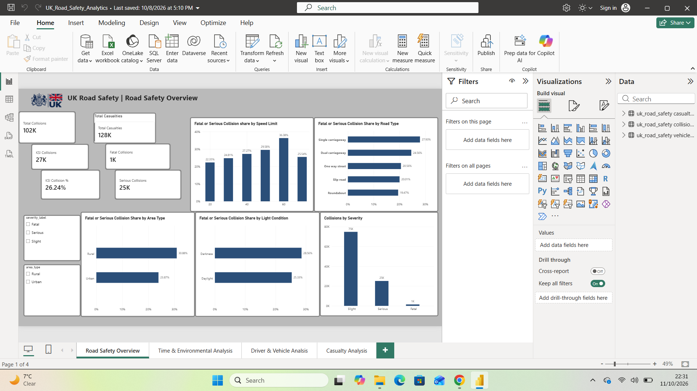
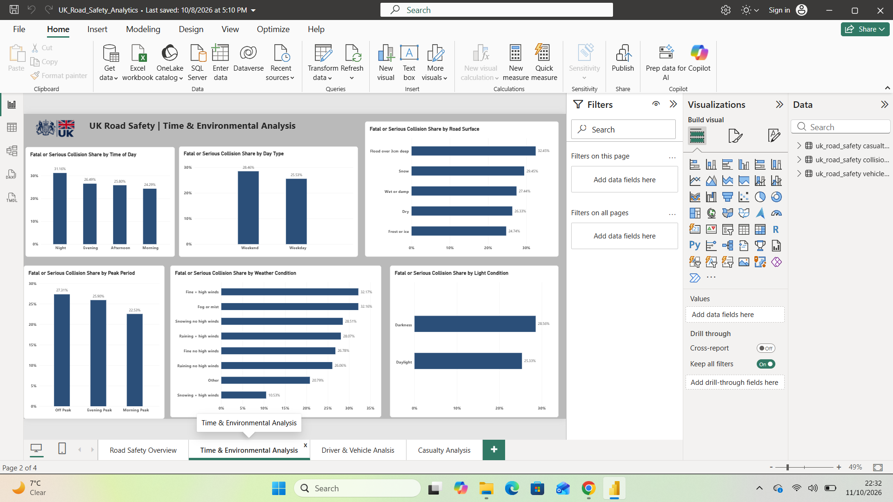
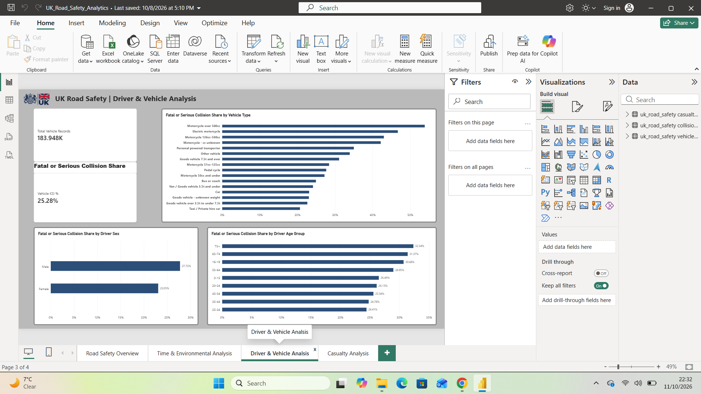
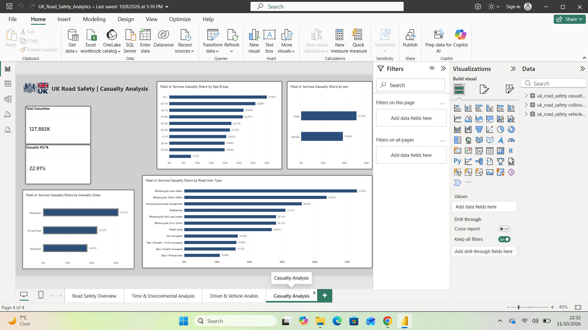

# UK Road Safety Analytics

## About the Project

I built this project to explore UK road safety data and understand the patterns behind road collisions and casualty severity.

Rather than focusing only on creating a dashboard, I wanted to work through the complete data analysis process — starting with raw data, checking and cleaning it in Python, analysing it further using SQL, and finally presenting the findings in an interactive Power BI dashboard.

The project uses three datasets covering **collisions, vehicles and casualties**, which allowed me to look at road safety from several different perspectives.

## What I Wanted to Find Out

The main goal was to understand where and under what conditions fatal or serious outcomes appear more frequently in the recorded data.

Some of the questions I explored were:

- How does collision severity change across different speed limits?
- Are fatal or serious collisions more common in rural or urban areas?
- How do lighting, weather and road surface conditions relate to collision severity?
- Are there noticeable differences between weekdays and weekends?
- At what times of day is the share of fatal or serious collisions highest?
- Which driver age groups and vehicle types are involved in more severe collisions?
- Which road users and casualty age groups have the highest proportion of fatal or serious injuries?

I then used Power BI to bring these findings together into an interactive dashboard that makes the results easier to explore and communicate.

## Data Source

The data comes from the **UK Department for Transport (DfT) Road Safety Open Data** published on GOV.UK.

Official dataset:
https://www.gov.uk/government/statistical-data-sets/road-safety-open-data

For this project, I worked with three main datasets:

- **Collisions** – details about recorded road collisions and the conditions in which they occurred
- **Vehicles** – information about the vehicles and drivers involved in those collisions
- **Casualties** – information about people injured in the collisions

The datasets can be connected using the collision identifier, which allowed me to analyse collision information together with vehicle and casualty data.

## Tools Used

- **Python (Pandas)** – data profiling, cleaning, transformation and exploratory analysis
- **Jupyter Notebook** – developing and documenting the Python analysis
- **MySQL** – storing the cleaned datasets and performing SQL analysis
- **Power BI** – data modelling, DAX measures, interactive analysis and dashboard development
- **VS Code** – managing the project files and development workflow
- **Git/GitHub** – version control and sharing the finished project

## Project Workflow

I approached the project in four main stages:

**1. Data Profiling**

I first explored the raw datasets to understand their structure, size, missing values, duplicate records and relationships. I also checked that vehicle and casualty records could be matched correctly to the collision dataset.

**2. Data Cleaning and Preparation**

Using Python, I cleaned and transformed the raw data before analysis. This included handling missing values, converting dates and times, creating age groups, and translating coded fields into meaningful categories such as collision severity, road type, weather, lighting conditions and road surface conditions.

I also created additional fields such as time of day, peak period, weekday/weekend and urban/rural classifications to make the analysis more useful.

**3. SQL and Exploratory Analysis**

After cleaning the data, I loaded the datasets into MySQL and used SQL alongside Python to investigate patterns in collision severity.

I looked at areas such as speed limits, road types, lighting conditions, weather, road surfaces, driver characteristics, vehicle types and casualty characteristics.

**4. Power BI Dashboard**

Finally, I connected the cleaned data in Power BI, created relationships between the collision, vehicle and casualty tables, developed DAX measures and built an interactive dashboard to communicate the main findings.

The finished report contains four pages:

1. **Road Safety Overview**
2. **Time & Environmental Analysis**
3. **Driver & Vehicle Analysis**
4. **Casualty Analysis**

## A Note on the Analysis

Throughout the project, I use KSI to refer to **Killed or Seriously Injured**, meaning fatal and serious outcomes combined.

The percentages shown in the dashboard represent the share of recorded collisions or casualties that were fatal or serious within each group.

These results should therefore be interpreted as patterns within the recorded road safety data rather than as direct measures of individual risk or proof that a particular factor causes more severe collisions.


## Key Findings

After analysing the collision, vehicle and casualty data, I found several interesting patterns:

- **Rural collisions were more severe than urban collisions.** Around 28–29% of recorded rural collisions were fatal or serious, compared with around 23–24% in urban areas.

- **60 mph roads had the highest fatal or serious collision share** among the speed limits analysed, at approximately **36.38%**.

- **Night-time collisions showed the highest severity share by time of day**, with around **31.9%** of recorded night-time collisions classified as fatal or serious.

- **Weekend collisions were more severe than weekday collisions.** The fatal or serious collision share was **28.46% on weekends**, compared with **25.53% on weekdays**.

- **Darkness was associated with a higher proportion of severe collisions than daylight.** This pattern was also visible across different speed limits.

- **Older casualties experienced particularly high severity proportions.** Among recorded casualties aged **75+**, approximately **34.96%** were killed or seriously injured, the highest percentage among the age groups analysed.

- **Pedestrians had the highest fatal or serious casualty share by casualty class**, at approximately **31.01%**, compared with drivers/riders and passengers.

- **Motorcycle users stood out in both the vehicle and casualty analysis.** Collisions involving motorcycles over 500cc had a particularly high fatal or serious collision share, while casualties associated with motorcycles over 500cc had a fatal or serious injury share of approximately **52.93%**.

These findings highlight groups and conditions associated with more severe outcomes in the recorded data. They should not be interpreted as exposure-adjusted risk or evidence that any individual factor directly causes severe collisions.

## Power BI Dashboard

I created a four-page Power BI dashboard to present the main findings from the analysis. Each page focuses on a different part of the road safety data.

### 1. Road Safety Overview

This page provides a high-level view of collisions and casualties, including total collisions, total casualties, fatal and serious collisions, and the overall KSI collision percentage. It also allows the results to be explored by severity and area type.



### 2. Time & Environmental Analysis

This page explores how collision severity varies across time of day, weekdays and weekends, peak periods, lighting conditions, weather and road surface conditions.



### 3. Driver & Vehicle Analysis

This page focuses on the vehicles and drivers involved in collisions. It compares fatal or serious collision shares across vehicle types, driver age groups and driver sex.



### 4. Casualty Analysis

This page looks specifically at injury outcomes, including differences across casualty age groups, sex, casualty class and road-user type.



## Project Structure

```text
UK-Road-Safety-Analytics/
│
├── data/
│   ├── raw/                 # Original road safety datasets
│   └── processed/           # Cleaned datasets used for analysis
│
├── python/
│   ├── 01_data_profiling.ipynb
│   ├── 02_data_cleaning.ipynb
│   └── 03_exploratory_analysis.ipynb
│
├── sql/
│   ├── create_collisions_table.sql
│   ├── create_vehicles_table.sql
│   ├── create_casualties_table.sql
│   ├── generate_table.py
│   └── road_safety_analysis.sql
│
├── power bi/
│   └── UK_Road_Safety_Analytics.pbix
│
├── images/                  # Power BI dashboard screenshots
├── documentation/
├── requirements.txt
└── README.md

## Skills Demonstrated

Through this project, I developed and demonstrated practical skills in:

- Data profiling and data quality checks
- Data cleaning and transformation using Python and Pandas
- Exploratory data analysis
- SQL querying and relational data analysis
- Working with multiple related datasets
- Data modelling in Power BI
- Creating DAX measures and KPIs
- Designing interactive dashboards
- Identifying and communicating data-driven insights
- Understanding analytical limitations and avoiding misleading conclusions